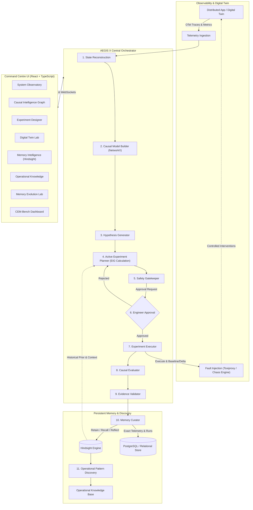

# AEGIS X — System Architecture & Technical Specification

**Project:** AEGIS X  
**Full Name:** The Self-Experimenting Reliability Scientist  
**Tagline:** *Don't just remember what broke. Discover why it broke.*  
**Core Paradigm:** Intervention-Grounded Operational Memory (IGOM)

---

## 1. Executive Summary & Vision

Traditional SRE and AIOps platforms act as retrospective chroniclers: they aggregate telemetry, detect threshold breaches, correlate log patterns, and use heuristic or generative models to suggest likely root causes. However, correlation is not causation. In modern microservice topologies characterized by asynchronous messaging, circuit breakers, and cascading backpressure, two completely disjoint root causes (such as downstream network packet loss vs. database connection pool exhaustion) can manifest with identical top-level symptoms (e.g., HTTP 503, elevated checkout latency, retry storms).

**AEGIS X** fundamentally shifts reliability engineering from passive pattern matching to **active scientific experimentation**:
1. **State Reconstruction:** Ingests live metrics, distributed traces, and logs to reconstruct an empirical state representation.
2. **Causal Graph Modeling:** Derives directed dependency structures connecting services, metrics, and failure modes.
3. **Hypothesis Generation:** Formulates competing, falsifiable hypotheses, assigning initial prior probabilities and explicit prediction criteria.
4. **Active Experiment Planning:** Calculates Expected Information Gain (EIG) over candidate interventions to select the optimal experiment that maximizes entropy reduction while minimizing execution cost and operational risk:
   $$\text{Score}(E) = \frac{\text{IG}(E)}{\text{Cost}(E) + \lambda \times \text{Risk}(E)}$$
5. **Safety Gatekeeping & Approval:** Enforces strict boundary checks, target validation, resource caps, and mandatory human-in-the-loop (HITL) authorization before any physical intervention occurs.
6. **Isolated Experiment Execution:** Executes controlled interventions in an isolated test environment (or digital twin), taking pre-intervention baselines, executing the perturbation, recording telemetry deltas, and validating full system recovery.
7. **Causal & Evidence Evaluation:** Evaluates measurements against candidate hypotheses, classifying evidence as supporting, contradicting, or inconclusive.
8. **Intervention-Grounded Operational Memory (IGOM) via Hindsight:** Retains structured experimental experiences (facts, interventions, counterfactuals, disproven paths) in Hindsight, allowing subsequent investigations to recall prior interventions and adapt future experiment selection based on environmental conditions.

---

## 2. High-Level System Architecture Diagram

---

## 3. Core Engine Pipeline & Lifecycle

### Step 1: Telemetry Ingestion & State Reconstruction
- Monitors request rates ($R$), error rates ($E$), latencies ($L$ - $p_{50}, p_{95}, p_{99}$), and resource utilization ($U_{\text{cpu}}, U_{\text{mem}}, U_{\text{conn}}$).
- Detects SLO breaches and triggers an incident session.
- Pinpoints the blast radius and timeline of telemetry deviation.

### Step 2: Causal Dependency Graph Construction
- Constructs a directed acyclic or cyclic service graph $G = (V, E)$ using NetworkX.
- Vertices $V$ represent microservices and infrastructure components; edges $E$ denote upstream-downstream call dependencies with propagation weights.
- Associates anomaly scores with nodes and edges.

### Step 3: Competing Hypothesis Generation
- Given the anomalous symptom vector $S$, generates $K \ge 2$ mutually competing hypotheses $H_1, H_2, \dots, H_K$.
- Formulates:
  - Prior probability $P(H_i)$.
  - Necessary condition $C_{\text{nec}}(H_i)$: telemetry patterns that *must* hold if $H_i$ is true.
  - Predicted perturbation response: $\Delta Y | \text{do}(X) \sim P(\Delta Y | H_i, \text{do}(X))$.

### Step 4: Active Experiment Planning & Information Gain
- The planner evaluates a library of candidate safe interventions $\mathcal{E} = \{E_1, E_2, \dots, E_m\}$.
- For each experiment $E_j$, it estimates the Expected Information Gain:
  $$\text{IG}(E_j) = \mathcal{H}(\mathcal{H}) - \sum_{o \in \Omega} P(O = o \mid E_j) \mathcal{H}(\mathcal{H} \mid O = o)$$
- Computes execution cost $\text{Cost}(E_j)$ and system risk $\text{Risk}(E_j)$.
- Scores experiments using the Pareto-optimal formulation:
  $$\text{Score}(E_j) = \frac{\text{IG}(E_j)}{\text{Cost}(E_j) + \lambda \times \text{Risk}(E_j)}$$
- If Hindsight memory indicates an identical intervention was previously performed under identical conditions, the prior is dynamically updated to avoid redundant experiments or to prioritize distinguishing tests.

### Step 5: Safety Gatekeeper & Engineer Approval
- Validates that the target is inside the isolated experimental environment.
- Enforces strict parameter bounds (e.g., maximum latency injection $\le 500\text{ ms}$, packet drop $\le 15\%$, duration $\le 30\text{ s}$).
- Issues a structured proposal to the operator with predicted impact, rollback plan, and expected evidentiary yield.
- Human engineer grants one-click cryptographically recorded approval or rejects the experiment.

### Step 6: Isolated Experiment Execution
- Takes a pre-intervention baseline measurement window ($T_{\text{pre}}$).
- Applies the controlled intervention (e.g., Toxiproxy toxic injection or container cgroup throttle).
- Ingests post-intervention telemetry during window ($T_{\text{post}}$).
- Removes the intervention and verifies that the system has recovered to baseline ($T_{\text{recov}}$).
- If recovery is not detected within deadline $T_{\text{timeout}}$, initiates an automated emergency rollback.

### Step 7: Causal & Evidence Evaluation
- Compares measured deltas against predictions under each hypothesis.
- Computes posterior probabilities $P(H_i \mid \text{Evidence})$ using Bayesian updating or likelihood ratios.
- Classifies evidence into three explicit categories:
  - **Supporting:** Confirms predicted response.
  - **Contradicting:** Disproves necessary condition or prediction.
  - **Inconclusive:** Measurement noise exceeds signal delta.

### Step 8: Hindsight Retention & Reflection
- Retains the structured record in Hindsight:
  - Bank ID: `aegis-operational-memory`
  - Content: Rich natural-language and structured causal distillation of what broke, what was hypothesized, what was intervened, what occurred, and what was falsified.
- Invokes Hindsight `reflect` to synthesize cross-incident patterns into stable operational observations and opinions.
